# 鹈鹕测试 · The Pelican Test

> 一只鹈鹕骑着自行车，穿过六千年美术史。
> **全片没有一笔是手绘的，也没有一个素材文件——每一帧和每一个音都是算出来的。**

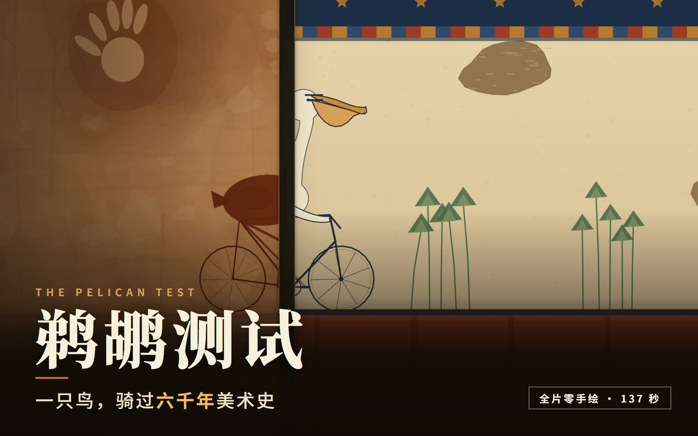

**137.0 秒 · 1920×1080 · 30 fps · AAC 48 kHz 立体声**

---

## 这是什么

一段 2 分 17 秒的短片。二十段画面首尾相接，铺成一条长卷；镜头一直往右走，
鹈鹕钉在画面 42% 的位置上骑，脚下的地在走。每走过一道缝，画风就换一次——
从撒哈拉的赭石岩画，一路到代码编辑器里的荧光字形。

二十块不是二十张图，而是**同一只鸟、同一套动作、同一辆车，被二十种笔法各画了一遍**。
所以它在撒哈拉是实心赭石剪影，在汉画像石是拓片反白的白形黑线，在浮世绘是墨线平涂，
在蒸汽波是霓虹描边——但轮子的圆心、车架的下管、鸟身的轮廓，在换笔的那一帧严格重合。

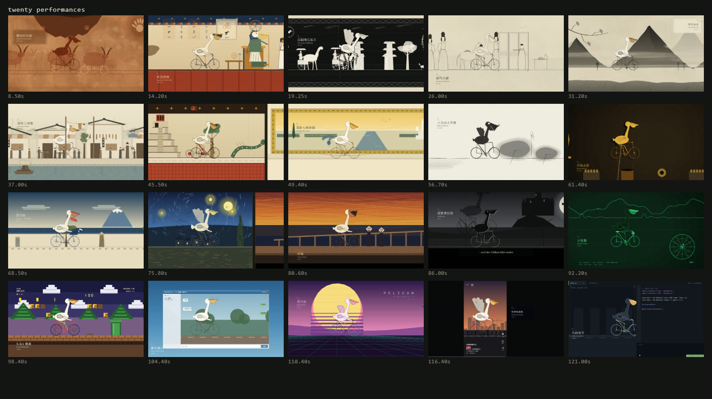

---

## 二十个版块

时间码从 5.0 秒起，每块 6 秒（三小节，120 BPM）。

| # | 版块 | 年代 | 画法 | 鹈鹕在做什么 |
|---|---|---|---|---|
| 01 | 撒哈拉岩画 | 约前 4000 | 实心赭石剪影、程序生成的砂岩底材 | 缩脖前伸，从一块压得很低的岩檐下钻过，檐上落下赭石细粉 |
| 02 | 埃及墓室壁画 | 约前 1300 | 平涂矿物色 + 深蓝描边，三层 register | 伸长脖子，用喙去碰王名圈里刻着的那辆自行车；碰到时墙上荡开一圈金光 |
| 03 | 汉画像石拓片 | 约 100 | 拓片反白，黑地白形 + 黑刻线 | 前轮碾进石缝，车头一沉，张开翅膀保持平衡，石屑从缝里蹦出来 |
| 04 | 唐代白描 | 约 750 | 细墨线，极淡绢色垫底 | 低头看仕女团扇上画着的自己；扇面里那只小鸟随后睁开了眼 |
| 05 | 宋代山水 | 约 1000 | 多边形扫描线填充、披麻皴、连绵山体 | 抬起头看那座永远骑不到顶的峰；前景一枝松枝压住构图 |
| 06 | 清明上河图 | 约 1100 | 淡彩街市、瓦垄、酒旗、前景河道 | 缩脖，从街心的晾布绳下钻过去，三块布被带得摆起来 |
| 07 | 玛雅抄本 | 约 1200 | 树皮纸红黑两色、方块象形 | 低头看自己那只当历法用的前轮；右上角长纪年一格一格跳 |
| 08 | 莫卧儿细密画 | 约 1600 | 金地 + 装饰边框 + 高视平线花园 | 骑在画框下沿上，金线被两只轮子各压出一道弧——边框是软的 |
| 09 | 八大山人写意 | 约 1690 | 墨团、飞白、大片空白 | 一只苍蝇落在喙尖，猛地一啄，没中 |
| 10 | 爪哇皮影 | 约 1800 | 琥珀偶、可见的关节杆与销钉 | 操偶师一拉杆，翅膀被扯起来、头跟着一甩，拉杆当场弯掉 |
| 11 | 浮世绘 | 1830s | bokashi 渐变、主版墨线 | 扭头去啄跃出水沟的鲤鱼，喙张着，差一点 |
| 12 | 星月夜 | 1889 | 顺流场的短笔触、旋涡 | 风太大，索性站起来张开翅膀骑，尾羽也张开 |
| 13 | 呐喊 | 1893 | 扭动的色带、斜压的桥栏 | 整幅画里唯一在喊的那个就是它；声波从喙尖一圈圈推出去 |
| 14 | 诺斯费拉图 | 1922 | 黑白剪影、月光勾边、胶片颗粒 | 抬头看自己的影子——影子不跟着走，它自己站起来、被拉长、脱开轮子 |
| 15 | 示波器 | 1950s | 双踪波形、李萨如、扫描线 | 站起来蹬，心率与波形跟着上去 |
| 16 | 8-bit 平台游戏 | 1980s | 8 单位网格量化、三层视差、HUD | 抬头一口啄下那枚金币，金币消失，像素字 `100` 往上跳 |
| 17 | 聊天窗口 | 2000s | 透明窗口，气泡画在 2D 覆盖层 | 抬头看一条砸在头上的消息 |
| 18 | 蒸汽波 | 2010s | 切片落日、透视网格、大理石胸像 | 张开一边翅膀；轮子每压过一次网格，荡出一圈霓虹 |
| 19 | 竖屏短视频 | 2020s | 9:16 视口内嵌第二套坐标、虚构 App 界面 | 对着镜头挥翅、点头，满屏飘心 |
| 20 | 代码美学 | 2020s | IDE、逐行打字、终端 | 低头对着键盘猛啄一下——回车 |

### 挑几帧看

| | | |
|---|---|---|
| 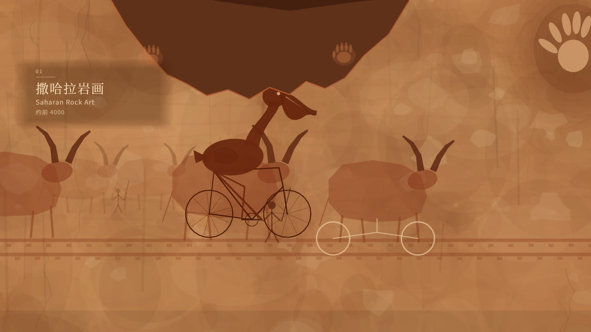 | 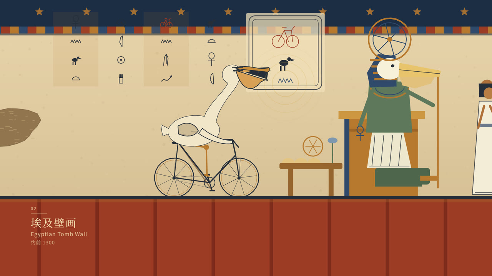 | 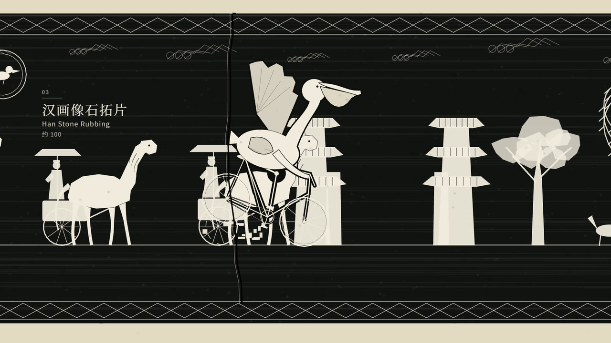 |
| 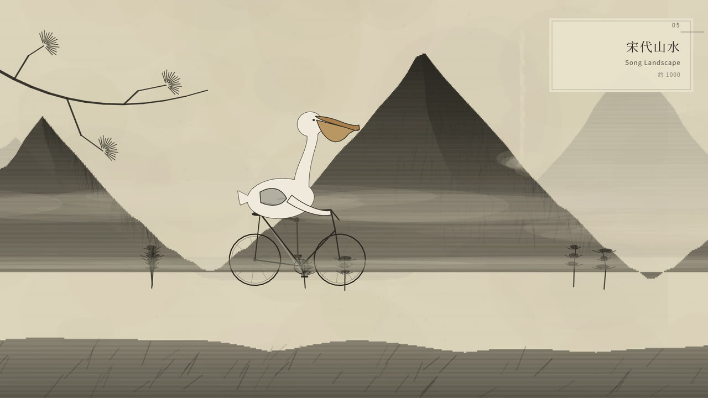 | 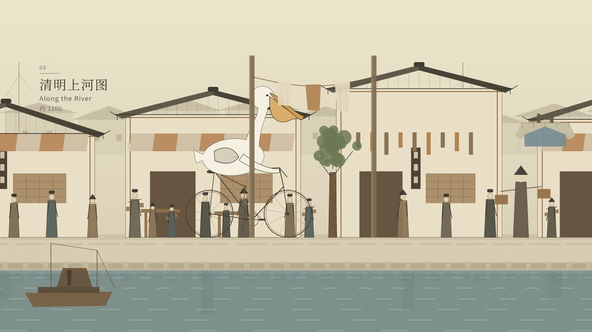 | 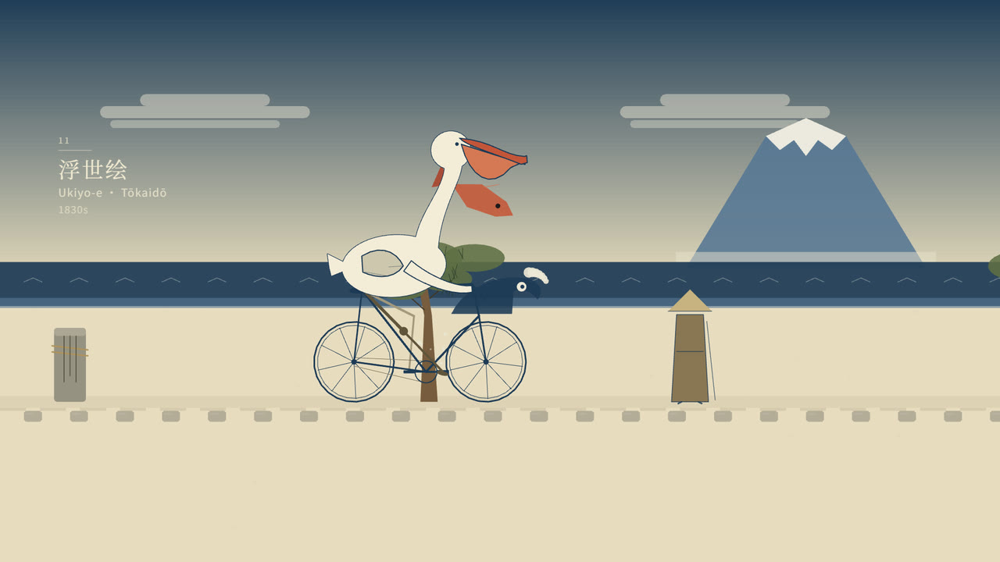 |
| 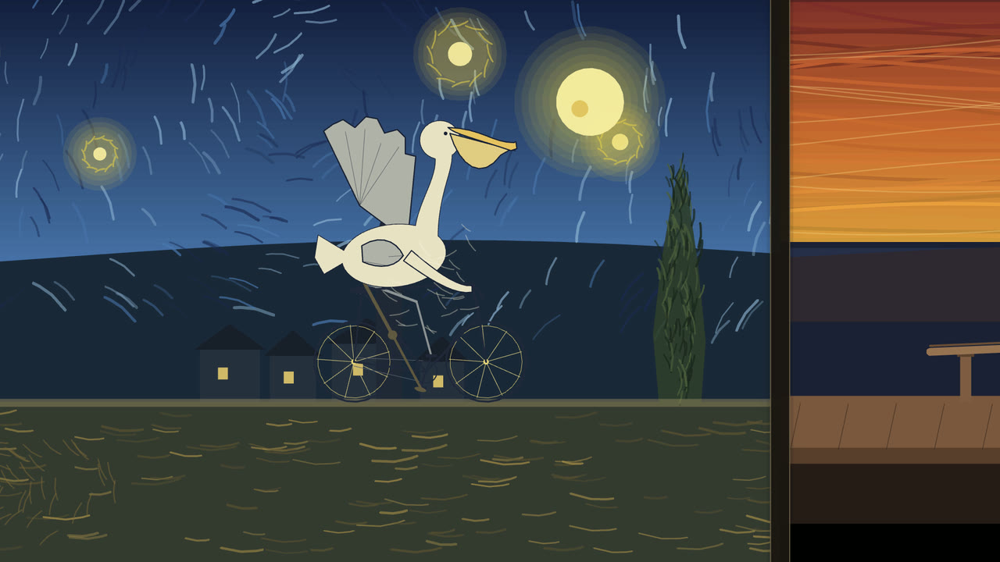 | 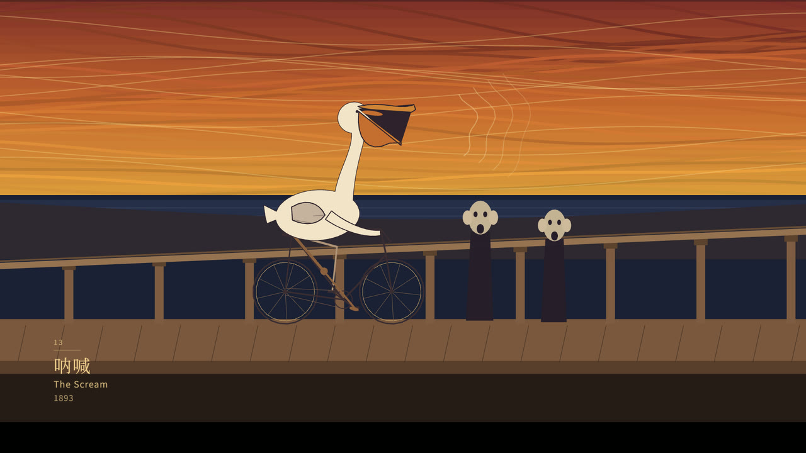 | 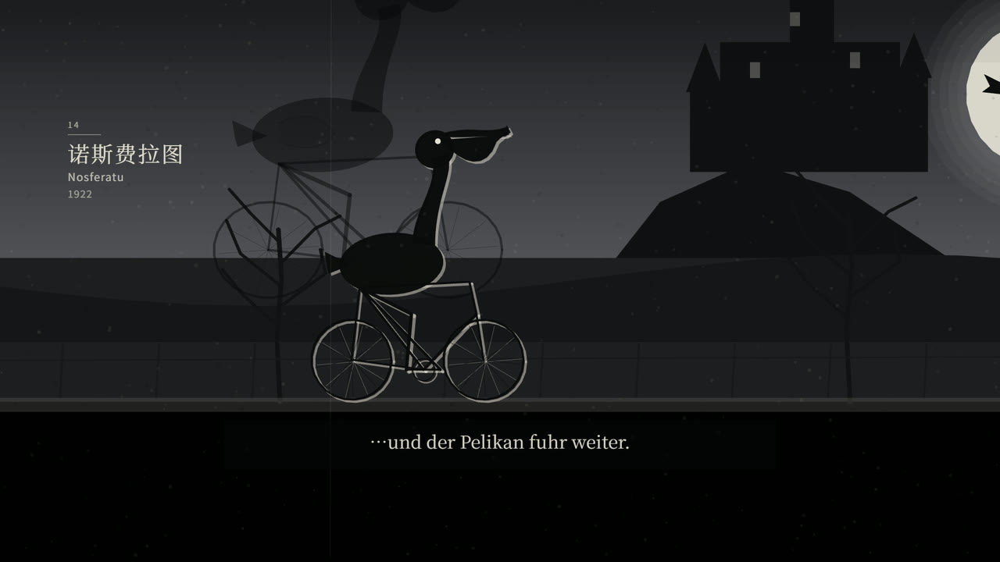 |
| 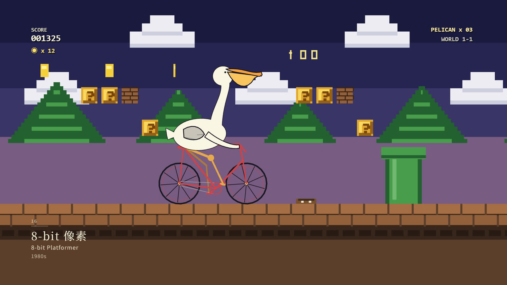 | 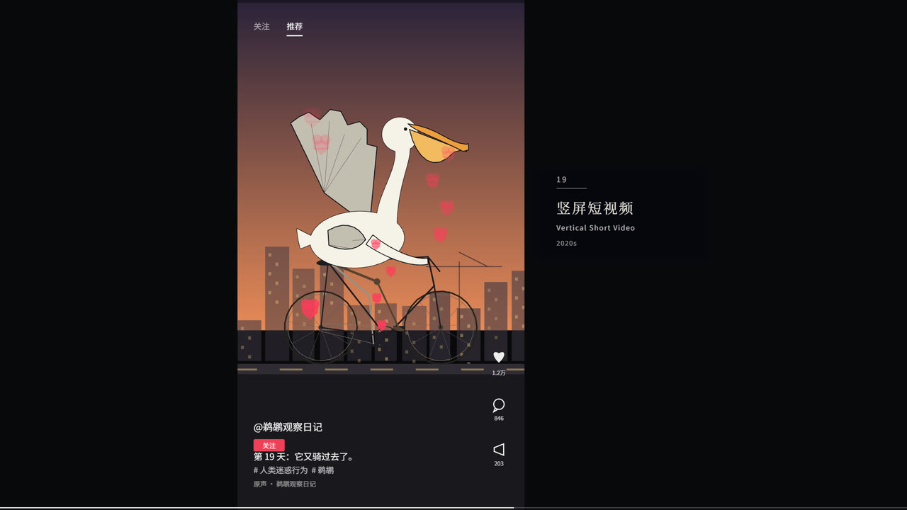 | 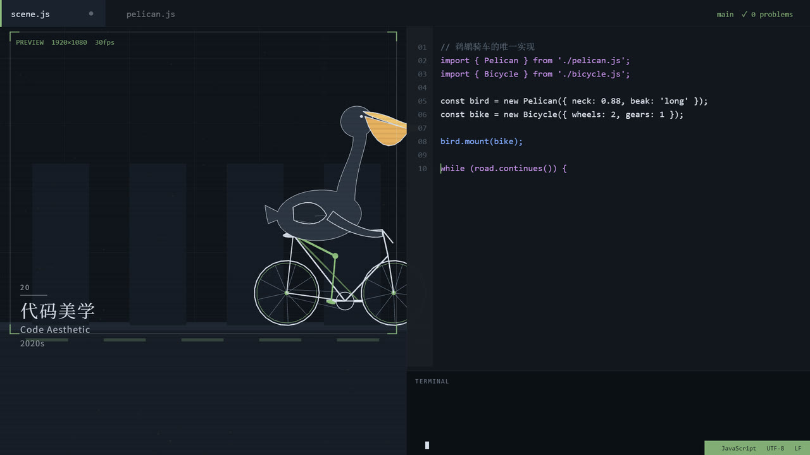 |

---

## 它是怎么做的

### 一条时间轴，全片唯一事实来源

`src/beat/timeline.js` 定义 120 BPM、每块三小节（6 秒）、20 块、引子 5 秒、尾声 12 秒。
拍点原点定在 **t₀ = 1.0 s**，于是所有小节线落在 `1 + 2n` 上——
`5 / 11 / 17 / … / 125` 就一个不差地成了正拍。**二十个版块边界全部踩在强拍上，不用凑。**

画面和声音都从这里取时间，所以配乐不是"做完画面再贴"，而是两边同时长出来的。

### 一条长卷，而不是二十张图

早期版本做的是"每块一幅静止的画 + 结尾穿框转场"，这是错的。现在是：

- 每段在长卷上宽 **1800 单位**，取景窗 **1000 单位**（1 单位 = 1.92 px）
- 镜头左边缘 = 骑手世界坐标 − 0.42 × 取景宽，所以镜头**匀速右移**，300 单位/秒
- 六秒走完 1800 单位，正好一块

每一块内部都经历三件事：左边的接缝扫出去 → **2.67 秒的纯本段**（梗落在这里）→ 右边的接缝扫进来。

### 一道缝

**38 px 宽**，画成装裱用的"隔水"竖带。缝扫过骑手的那零点几秒里，画风就换掉了。

关键是：**两半的鸟是同一个世界坐标、同一套姿势画出来的**。`pose(t, dist)` 是纯函数，
两边喂进去的参数完全一样，所以轮心、车架、身体的每一根线在像素上严格重合；
遮罩沿接缝切开后，左半是旧笔法、右半是新笔法。

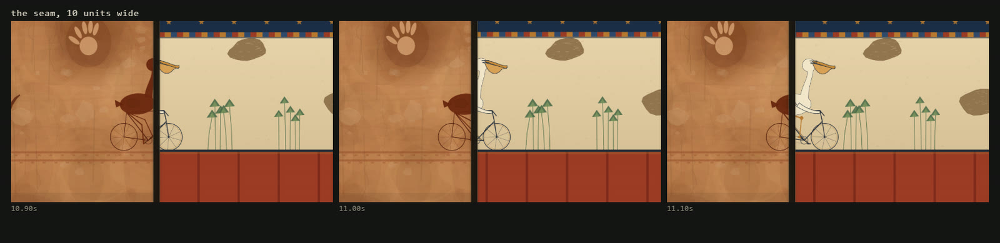

实现上，接缝在画面里时要同时画两段：先画"另一段"（不画骑手）→ 拍一张 0.2 ms 的快照 →
再画骑手所在段 → 在 2D 覆盖层上贴快照、按接缝位置把骑手那一侧掏空。

### 一只会演的鸟

`src/rig/rig.js` 是一个参数化骨骼木偶，输出纯几何，不含任何风格。除了"骑"，它还接受一组表演参数：

| 参数 | 作用 |
|---|---|
| `neckReach` / `neckLift` | 脖子前伸 / 抬高，整条 S 曲线跟着弯 |
| `headPitch` | 头部俯仰，绕颈端旋转（喙、喉囊、眼一起转） |
| `gape` | 张嘴：下颌带着喉囊绕喙根下旋，中间露出暗色口腔 |
| `wingRaise` | 展翅：腕关节 + 五根初级飞羽 |
| `hipLift` | 离座站起（腿的 IK 自动伸直） |
| `tailFan` / `lean` / `coast` | 尾羽张开 / 身体前后倾 / 停止踩踏 |

因为这些参数**只改几何、不改画法**，二十种笔法会一起继承同一个动作。

编排用 `src/kit/act.js` 的关键帧小语言，时间轴是版块进度 `p` 而不是秒数：

```js
import { perf } from '../kit/act.js';

const A = perf(g.p, {
  gape:  [[0.56, 0], [0.605, 0.9], [0.63, 1], [0.655, 0]],   // 猛地一啄
  pitch: [[0.56, -0.04], [0.605, 0.13], [0.72, 0]],
});
const pz = pose(t, { dist, gape: A.gape, headPitch: A.pitch });
```

### 二十种笔法

每个版块是一个独立文件 `src/scenes/sNN_*.js`，共用一套画笔（`src/kit/paint.js`、`stroke.js`）。
它们的技术路线并不相同，不是同一套滤镜换色：

- **宋代**用多边形扫描线逐行插值填充（`scanRows`），才有轮廓又有浓淡；皴法用自写的"锥形笔"
  （分段收细的折线），比笔刷库快两个数量级，才能一口气下三百笔
- **撒哈拉**是实心剪影，整只鸟和车是同一块颜料；砂岩底材程序生成后缓存
- **汉画像石**是拓片反白：同一只鸟先画一遍加粗的黑，再压一遍白形，中间自然留出一道刻线
- **星月夜**是 400 多笔顺流场的短笔触，旋涡中心是一只按物理转动的车轮
- **浮世绘**用 bokashi 渐变做天，海面用短促的白色弧线

### 声音

`tools/music.mjs` 直接算出 48 kHz 立体声 WAV，没有采样、没有第三方音源。

四件合成器（Karplus-Strong 拨弦、FM 钟、气声笛、带蜂鸣的弹拨）＋ 铺垫 ＋ 低音 ＋ 四种打击，
按 `TONE[k]` 每块配不同组合。所有事件都由时间轴推出：和声一小节换一个，低音每小节两下，
接缝前 0.18 秒必定有一声"换笔"的噪声扫频。

每块还有自己的记号音：皮影开场一记锣、星夜是钢片琴琶音、示波器是两个纯音、
聊天是按消息节奏的提示音、代码是 26 下打字机。**八大山人那块几乎全空，只留一声**——
因为那张画本来就只有一只鸟。

另有一条贯穿全片的花鼓声，按轮速 7.5 Hz 调制，压得很低。它不是音效，是"这只鸟一直在骑"的底噪。

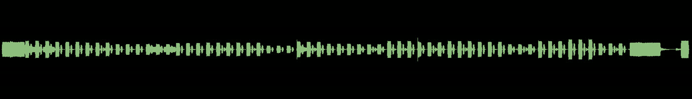

---

## 跑起来

### 依赖

| 需要 | 说明 |
|---|---|
| Node.js 22+ | 实测 22.22.2 |
| Chromium 内核浏览器 | 本机装了 Chrome / Edge 即可，脚本会自动找 Edge，不需要额外下载 |
| ffmpeg 9+ | 含 libx264 与 aac；编码与混音用，脚本会显式解析路径，不依赖 PATH |
| 中文字体 | Noto Serif SC / Noto Sans SC（或系统宋体、楷体）。字体不随仓库分发 |

```bash
npm install
```

### 预览

```bash
npm run serve       # → http://127.0.0.1:5173/
```

页面下方有播放条，可以拖动、暂停（预览页本身不出声，声音在合成的 MP4 里）。

### 出片

```bash
npm run music                       # 1. 生成配乐 → out/score.wav
npm run render -- --fps 30 --workers 6 --dir frames
                                    # 2. 逐帧渲染 → frames/（4110 张 PNG，约 4 分钟）
npm run encode -- --fps 30 --dir frames --out out/video.mp4
                                    # 3. 编码 H.264
npm run mux -- --video out/video.mp4 --out out/final.mp4
                                    # 4. 混入音轨，响度归一到 -16 LUFS
npm run shot -- --t 8.5 --out still.png
                                    # 或者只拍某一秒的单帧（可逗号分隔多个时间）
npm run sheet -- --times 8,14,20 --cols 5 --out sheet.png
                                    # 接触表
npm run perf                        # 量每一块的单帧绘制成本
```

> 帧序列很大（4110 张、约 200 MB），`frames*/` 与 `out/` 已加入 `.gitignore`。
> 单帧绘制约 39 ms，瓶颈在截图不在绘制，所以 60 fps 的代价只是帧数翻倍。

### 改一个版块

场景模块的契约只有四项，全部可选：

```js
export default {
  id: 'sahara',
  card: { x: 116, y: 322, color: 'rgba(246,220,186,', light: true, plate: true },

  // 每块自己的镜头（可选）：取景宽度可推可拉
  cam(p, riderX) { return { aperture: 1000, tilt: 0 }; },

  // 画世界。g = { t, p, dist, riderWorld, span, hasRider, riderLocal, cam }
  draw(g) { /* 用 p5 的 WEBGL 画布 */ },

  // 画界面（可选）：在 2D 覆盖层上，1080p 下文字是锐的
  overlay(ctx, g, fade) { /* 聊天窗口、App UI、字幕 */ },
};
```

三条硬约束：

1. **画幅上沿 = 286**。所有版块都从 `y ≤ 286` 开始铺底；镜头仰角不能让画幅越过这条线，
   否则接缝另一侧会露黑边。
2. **骑手永远 1:1**。缩放不同，接缝两侧的鸟就对不上；要"渺小"请用镜头（取景窗）而不是缩模型。
3. **场景不自己起拍**。所有时间从 `timeline.js` 取，否则接缝会错位。

---

## 目录

```
src/
  beat/timeline.js      全片唯一时间源：BPM、版块、拍点、场景索引
  main/camera.js        取景窗与长卷坐标
  main/stage.js         调度：谁在画、接缝在哪、2D 覆盖层
  main/boot.js          p5 双画布启动（WEBGL 画 + 2D 覆盖层）
  rig/rig.js            骨骼木偶：纯几何 + 表演参数
  rig/draw.js           两种画法：描边填色 / 单色剪影
  kit/                  数学、编排、画笔、锥形笔、底材、排字
  scenes/               intro、outro、s01–s20
tools/
  serve.mjs             本地静态服务
  shot.mjs / sheet.mjs  单帧 / 接触表
  render.mjs            多进程逐帧渲染
  encode.mjs / mux.mjs  H.264 编码 / 混音
  music.mjs             程序化配乐 → WAV
  perf.mjs              单帧成本测量
  cover/                B 站封面（HTML + 截图脚本）
docs/
  PLAN.md               制作计划与全过程记录（含每一阶段的技术取舍）
  ART_BRIEFS.md         二十块的美术简报
  RENDER_NOTES.md       渲染管线与踩过的坑
  BILIBILI.md           投稿文案（标题、简介、标签、分区）
```

---

## 几个被实测否决的方案

记下来是因为它们都"看起来应该更快 / 更好"：

| 方案 | 结果 |
|---|---|
| 用 p5.brush 当笔刷引擎 | 在 2D 画布下直接抛错，只能跑 WEBGL；framebuffer 分层又不可靠，笔触会漏到主画布。**整套笔法改为自写**，依赖已移除 |
| 把上千个颗粒合并成一次 `beginShape(TRIANGLES)` | **慢了 15%**。p5 2.x 的 immediate 模式按顶点收税，比它内部复用的圆几何更贵——"合并 draw call ≠ 更快" |
| 展翅做成"从肩部放射的五根羽" | 出来是一圈尖刺，像顶皇冠。最终是**腕关节 + 五根初级飞羽 + 深缺口**，才同时读得出"臂"和"羽" |
| 宋代把骑手缩到 0.34 制造"巨峰下的小人" | 缩放不同，接缝两侧的鸟就对不上。改成**骑手永远 1:1，渺小感由镜头给** |

---

## 已知不足

- **唐代白描**：团扇离骑手略远，"它在看自己"这层因果在成片里偏弱。
- **代码美学**：鸟会骑出预览窗格，而窗格边框没有裁剪它（WEBGL 下没有 clip）。
- **鹈鹕造型**：二十块共用一套骨骼，喉囊的垂坠感仍不够，是下一轮最值得改的地方。
- **宋代**皴法分布仍偏均匀，真山水的皴是成组的。

---

## 许可

- **代码**：MIT，见 [LICENSE](LICENSE)。可自由学习、修改、商用。
- **影片、封面、渲染帧、音轨**：保留所有权利。转载 / 二创请先联系。
- 第三方组件与公有领域作品说明见 [THIRD_PARTY_NOTICES.md](THIRD_PARTY_NOTICES.md)，
  参考与致谢见 [NOTICE.md](NOTICE.md)。

片中所有界面（聊天软件、短视频平台、游戏画面、新闻发布会席位）均为虚构，不使用任何真实品牌素材。
